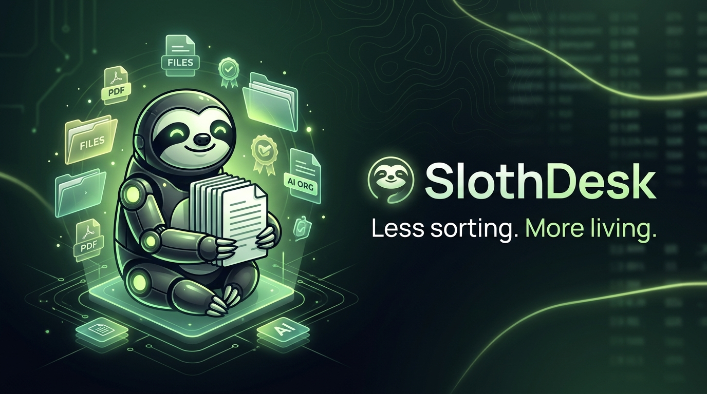

# 🦥 SlothDesk — Less sorting. More living.

[](https://dev.to/challenges)
[](https://fastapi.tiangolo.com)
[](https://react.dev)
[](https://www.typescriptlang.org)
[](https://vitejs.dev)
[](LICENSE)



> A local-first, AI-powered desktop dashboard that rewards laziness by safely organizing your cluttered Downloads folder with minimal user effort.

Built for the **DEV Hacktoberfest Open-Source AI Challenge Week 3: Slow and Steady**.

---

## Table of Contents
1. [Project Overview](#1-project-overview)
2. [The Problem SlothDesk Solves](#2-the-problem-slothdesk-solves)
3. [Architecture](#3-architecture)
4. [Technology Stack](#4-technology-stack)
5. [Model Selection & Hardware Requirements](#5-model-selection--hardware-requirements)
6. [LM Studio Setup](#6-lm-studio-setup)
7. [Native Windows Development Setup](#7-native-windows-development-setup)
8. [Podman & Compose Deployment](#8-podman--compose-deployment)
9. [Environment Variables](#9-environment-variables)
10. [API Endpoints](#10-api-endpoints)
11. [Safety & Approval Model](#11-safety--approval-model)
12. [Undo Behavior & Manifest Audit](#12-undo-behavior--manifest-audit)
13. [Test Commands & Verification](#13-test-commands--verification)
14. [Known Limitations](#14-known-limitations)
15. [Challenge Submission & Demo Instructions](#15-challenge-submission--demo-instructions)

---

## 1. Project Overview

**SlothDesk** brings high-accuracy local artificial intelligence directly to your filesystem without sending private filenames, metadata, or documents to third-party cloud APIs.

Rather than giving an autonomous AI model unrestrained write access to your hard drive, SlothDesk implements a disciplined, **two-phase architecture**:
1. **Planning Phase (Read-Only)**: Files in your designated Downloads folder are scanned and categorized by an AI agent into structured folders (`Documents`, `Images`, `Videos`, `Audio`, `Archives`, `Code`, `Other`).
2. **Review & Approval Gate**: The user inspects proposed source-to-destination mappings, collision safe-renames, and AI reasoning.
3. **Verified Execution**: The backend independently verifies file sizes, timestamps, and cryptographic SHA-256 hashes right before moving each file.
4. **Instant Rollback**: Every operation produces an immutable JSON audit manifest, enabling one-click reversibility at any time.

---

## 2. The Problem SlothDesk Solves

The `Downloads/` directory is notoriously where productivity goes to die. Files of every type—invoices, memes, code snippets, compressed archives, and firmware—pile up in an unmanageable mess. 

Manual sorting requires tedious decision-making, while existing automated tools rely either on rigid keyword scripts or risky cloud AI tools that demand your sensitive files and charge recurring subscription fees.

SlothDesk solves this with:
- **Zero Cloud Leaks**: 100% offline local inference using LM Studio.
- **Zero Overwrites**: Deterministic collision detection ensures no file is ever overwritten.
- **Zero Model Shell Privileges**: The AI model cannot execute shell commands or write code.
- **Zero Regret**: Every move is reversible via persistent manifests.

---

## 3. Architecture

SlothDesk strictly isolates the untrusted AI reasoning engine from filesystem mutation logic:

```text
[ Browser / React 19 Dashboard ]
             |
             v  HTTP REST (Strict CORS)
[ FastAPI Backend Engine ]
   ├── Scanner (Confinement & Symlink Rejection)
   ├── Agent Harness (smolagents.ToolCallingAgent)
   │     ├── Tool: get_file_metadata(filename)
   │     ├── Tool: get_allowed_categories()
   │     └── Tool: validate_category(category)
   │            |
   │            v
   │     [ Local LM Studio API / Qwen2.5-7B ]
   │            | (Fallback if offline)
   │     [ Deterministic Rule Engine ]
   │
   ├── Planner (Collision Detection & TTL Expiration)
   │     └── Outputs Proposed Plan (0 files changed)
   │
   └── [ User Approval Gate ]
         └── Executor (Atomic Moves & SHA-256 Check)
               └── Manifest Store (.slothdesk_data/manifests)
```

For complete details on why the model is forbidden from directly manipulating files, see [`docs/ARCHITECTURE.md`](docs/ARCHITECTURE.md).

---

## 4. Technology Stack

### Backend & Local AI
- **Python 3.11**
- **FastAPI**: Asynchronous REST API framework.
- **smolagents (`ToolCallingAgent`)**: Hugging Face's lightweight agent library, restricted strictly to typed read-only metadata tools.
- **LM Studio**: Local OpenAI-compatible server executing quantized open-source models on consumer hardware.
- **Pydantic & Pydantic-Settings**: Strict input/output schema validation.
- **pytest**: Automated unit and security testing.

### Frontend
- **React 19 & TypeScript**
- **Vite 6**: Fast client build tooling and local dev proxy.
- **lucide-react**: Lightweight icon library.
- **Restrained Nature Aesthetic**: Custom CSS system featuring forest green tones (`#0a130e`), soft lime accents (`#84cc16`), and warm off-white typography.

### Deployment & Containers
- **Podman**: Rootless, daemonless container engine.
- **Compose Workflow**: Multi-container setup with localhost-bound ports and read-only host protections.

---

## 5. Model Selection & Hardware Requirements

### Target Hardware Profile
- **GPU**: NVIDIA RTX 5050 Laptop GPU (8 GB VRAM)
- **System Memory**: 24 GB RAM
- **Storage**: ~5 GB for GGUF model storage

### Recommended Model
- **Model**: `Qwen2.5-7B-Instruct`
- **Quantization**: `GGUF Q4_K_M`
- **Context Window**: 8,192 tokens (8K)
- **Inference Server**: LM Studio (OpenAI-compatible `/v1` endpoint)

### Graceful Fallback Guarantee
If LM Studio is not running, SlothDesk automatically engages its **deterministic rule fallback engine**, allowing safe file scanning, collision handling, and organization based on verified extension maps. **The application never falsely claims an AI model was used when the fallback was active.**

---

## 6. LM Studio Setup

1. Download and install **LM Studio** from [lmstudio.ai](https://lmstudio.ai).
2. In the Search tab, search for `Qwen2.5-7B-Instruct-GGUF` and download the `Q4_K_M` quantization.
3. Open the **Developer / Local Server** tab in LM Studio:
   - Load the downloaded model into memory.
   - Set Context Length to `8192`.
   - Toggle **Start Server** on port `1234` (Default: `http://localhost:1234`).
4. Note your loaded model identifier displayed in the server controls (e.g. `qwen2.5-7b-instruct`). Set this in your `.env` as `LM_STUDIO_MODEL`.

---

## 7. Native Windows Development Setup

### Prerequisites
- Python 3.11 installed (or managed via `uv`).
- Node.js v20+ and npm.
- Git.

### Setup Instructions

1. **Clone the repository**:
   ```powershell
   git clone https://github.com/Ani0811/slothdesk.git
   cd slothdesk
   ```

2. **Configure environment**:
   ```powershell
   cp .env.example .env
   ```

3. **Backend Setup**:
   ```powershell
   # Create Python 3.11 virtual environment using uv
   uv venv .venv --python 3.11
   
   # Install dependencies
   uv pip install --python .venv -e backend
   uv pip install --python .venv pytest pytest-asyncio
   ```

4. **Frontend Setup**:
   ```powershell
   cd frontend
   npm install
   cd ..
   ```

5. **Generate Synthetic Demo Files**:
   ```powershell
   uv run python scripts/setup_demo_downloads.py
   ```

6. **Start Application**:
   - **Terminal 1 (Backend)**:
     ```powershell
     uv run uvicorn app.main:app --app-dir backend --reload --port 8000
     ```
   - **Terminal 2 (Frontend)**:
     ```powershell
     cd frontend
     npm run dev
     ```
   Open `http://localhost:5173` in your browser.

---

## 8. Podman & Compose Deployment

SlothDesk provides a hardened Podman Compose configuration in `infra/compose.yaml`.

### Container Security Features
- **Strict Localhost Binding**: Ports `8000` and `8080` bind strictly to `127.0.0.1`.
- **Scope Restriction**: Only the designated test Downloads folder is mounted (`/data:z`). The host root filesystem and user home directories are never mounted.
- **No New Privileges**: `security_opt: [no-new-privileges:true]`.
- **Unprivileged Execution**: Both containers run as non-root users (`slothuser` and `nginx`).
- **Host Inference Networking**: Resolves LM Studio via `host.containers.internal`.

### Running with Podman
```bash
# Navigate to infra directory
cd infra

# Start services using Podman Compose
podman compose up --build
```
Access the dashboard at `http://localhost:8080`.

---

## 9. Environment Variables

| Variable | Default | Description |
|:---|:---|:---|
| `SLOTHDESK_ROOT` | `./test_downloads` | Path to managed Downloads directory (mounted to `/data` in container). |
| `SLOTHDESK_DATA_DIR` | `./.slothdesk_data` | Storage directory for audit manifests and cached plans. |
| `LM_STUDIO_BASE_URL` | `http://localhost:1234/v1` | Local inference endpoint (`http://host.containers.internal:1234/v1` for containers). |
| `LM_STUDIO_MODEL` | `qwen2.5-7b-instruct` | Active model identifier in LM Studio. |
| `PLAN_EXPIRY_SECONDS` | `900` | Expiration window (in seconds) for unexecuted plans (15 min). |
| `HOST` | `127.0.0.1` | Backend host binding. |
| `PORT` | `8000` | Backend port. |
| `VITE_API_BASE_URL` | `http://localhost:8000/api` | API URL for frontend (proxied to `/api` in dev). |

---

## 10. API Endpoints

| Method | Endpoint | Description |
|:---|:---|:---|
| `GET` | `/api/health` | Reports backend status, LM Studio connectivity, active model, and manifest count. |
| `GET` | `/api/files` | Scans and lists loose top-level files in the managed root directory. |
| `POST` | `/api/plan` | Generates a proposed organization plan (Read-Only; modifies 0 files). |
| `GET` | `/api/plan/{plan_id}` | Retrieves a cached plan proposal by ID. |
| `POST` | `/api/execute/{plan_id}` | Executes an approved plan after revalidating hashes and state. |
| `GET` | `/api/undo` | Lists past execution manifests in reverse chronological order. |
| `POST` | `/api/undo/{manifest_id}` | Restores files to original paths using the audit manifest. |

---

## 11. Safety & Approval Model

SlothDesk adheres to a strict zero-trust model:
- **No Recursive Destruction**: Only files directly in the root directory are organized. Pre-existing subdirectories are left untouched.
- **Zero Overwrite Policy**: Destination names are checked against existing files on disk and prior claims in the plan. Collisions are safely resolved to `{stem}_{counter}{suffix}` (e.g. `invoice_1.pdf`).
- **Cryptographic State Check**: If a file is deleted, modified, or resized between plan creation and execution, the executor skips the move to prevent race conditions.
- **Symlink Disallowance**: Symbolic links are never followed or created.

For detailed security disclosures, see [`SECURITY.md`](SECURITY.md) and [`docs/SECURITY_TESTING.md`](docs/SECURITY_TESTING.md).

---

## 12. Undo Behavior & Manifest Audit

Every execution persists an immutable manifest JSON file in `SLOTHDESK_DATA_DIR/manifests/{manifest_id}.json`.

Manifests record:
- Unique `manifest_id` and UTC timestamp.
- List of moved files with pre-move SHA-256 hashes and sizes.
- List of skipped files and reasons.

When rolling back:
1. SlothDesk revalidates manifest paths as untrusted input.
2. If an original file location has since been re-occupied, SlothDesk **aborts the restore for that file** rather than overwriting new user data.
3. Successfully restored files are verified and empty category folders are cleaned up.

---

## 13. Test Commands & Verification

Run the complete backend test suite:
```bash
uv run pytest backend/tests -v
```

Run specific test suites:
```bash
# Planner & collision resolution tests
uv run pytest backend/tests/test_planner.py -v

# Executor & atomic undo tests
uv run pytest backend/tests/test_executor.py -v

# API endpoint lifecycle tests
uv run pytest backend/tests/test_api.py -v

# Dedicated path traversal and security tests
uv run pytest backend/tests/test_security.py -v

# Agent mock & fallback tests
uv run pytest backend/tests/test_agent.py -v
```

Build the frontend bundle:
```bash
cd frontend && npm run build
```

---

## 14. Known Limitations

1. **Top-Level Root Only**: By design, SlothDesk initially organizes only loose files directly in the configured Downloads folder. Existing subfolders are intentionally not recursively organized to prevent reorganizing complex existing structures.
2. **Offline Inference vs Initial Setup**: While model inference is 100% offline via LM Studio, initial Python dependencies (`pip install`) and Node packages (`npm install`) require internet access during installation.
3. **Symlinks on Windows**: Under standard unprivileged Windows environments without Developer Mode enabled, creating OS-level symlinks is restricted; SlothDesk safely detects and skips symlink creation in those environments.

---

## 15. Challenge Submission & Demo Instructions

See [`docs/DEMO_SCRIPT.md`](docs/DEMO_SCRIPT.md) for a comprehensive, 3-minute video recording script demonstrating:
- The initial cluttered folder.
- AI scanning with transparent model mode reporting.
- Deterministic collision handling (`invoice_1.pdf`).
- The explicit approval modal gate.
- Successful organization into categorized subfolders.
- Instant undo restoration.
- All 28 automated tests passing.

---

## License

MIT License. Designed and engineered for the DEV Hacktoberfest 2026 Open-Source AI Challenge.
