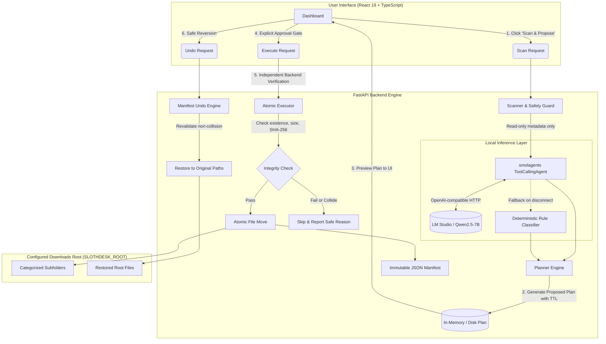

# SlothDesk System Architecture

> **Core Philosophy:** SlothDesk should make file organization effortless for the user, not make filesystem changes effortless for an untrusted AI model.

## 1. High-Level Architecture Overview

SlothDesk separates file classification reasoning from filesystem mutation. The application implements an explicit **two-phase workflow** with an unskippable user approval gate.

---

## 2. Why the AI Model Cannot Directly Manipulate Files

Many contemporary "AI agent" frameworks grant language models raw tool access to execute arbitrary Python code (`CodeAgent`), shell commands, or low-level filesystem APIs (`os.remove`, `shutil.rmtree`, `os.rename`). 

In SlothDesk, this is treated as an unacceptable security risk for the following reasons:

1. **Non-Deterministic Tool Invocations**: An LLM can hallucinate paths, misinterpret relative paths as absolute system directories, or execute destructive commands under ambiguous context.
2. **Path Traversal & Root Escapes**: A model instructed to move files might attempt `../../Windows/System32` or follow symbolic links into sensitive user files outside of Downloads.
3. **Unintended Overwrites**: If two files share names or common patterns, a raw move tool can silently clobber existing documents without recovery options.
4. **Lack of Auditability**: Dynamic script execution leaves behind no structured, parseable audit trail for automatic rollbacks.

### The SlothDesk Defense Model: Read-Only Tooling
In SlothDesk, the `smolagents.ToolCallingAgent` is supplied with **only 3 read-only metadata tools**:
- `get_file_metadata(filename: str)`: Returns pre-scanned size, name, and extension. Does NOT read file contents.
- `get_allowed_categories()`: Returns the static allowlist: `['Documents', 'Images', 'Videos', 'Audio', 'Archives', 'Code', 'Other']`.
- `validate_category(category: str)`: Returns a boolean confirmation of whether a category string is permissible.

The model has **zero tools** to:
- Move files
- Delete files
- Read file byte contents
- Touch paths outside the pre-scanned inventory
- Execute commands or write scripts

---

## 3. Two-Phase Execution Lifecycle

### Phase 1: Planning (Read-Only)
1. **Scanner**: Scans files residing directly in `SLOTHDESK_ROOT`. It rejects symlinks, hidden files (`.slothdesk*`), and ignores subdirectories (does not recursively reorganize without separate approval).
2. **Classification**:
   - If LM Studio is connected (`GET /v1/models` succeeds), `smolagents.ToolCallingAgent` classifies files into one of the 7 allowed categories.
   - If LM Studio is offline or inference fails, the application falls back safely to the deterministic extension rule engine. The mode is accurately and transparently displayed in the UI as `deterministic_fallback`.
3. **Collision Detection**: The planner checks if `{Category}/{filename}` already exists on disk or was claimed by another file in the plan. If a collision is detected, SlothDesk deterministically calculates `{name}_{counter}{ext}` (e.g. `report_1.pdf`) to guarantee zero overwrites.
4. **Cryptographic State Capture**: The planner captures the SHA-256 hash, byte size, and modification timestamp for every file in the proposal, then sets a plan expiry window (default: 15 minutes).

### Phase 2: Execution (Approved & Verified)
1. **Approval Gate**: The user reviews all proposed relocations, collision notices, and reasons. The user must explicitly trigger execution (`POST /api/execute/{plan_id}`).
2. **Backend Revalidation**: The backend does NOT trust the frontend. Before moving each file, it re-verifies:
   - Plan exists and has not expired.
   - Source file still exists at the expected path.
   - Source file is not a symlink.
   - Current file size and SHA-256 hash match the values captured during planning. (If modified since planning, the move is skipped to avoid race conditions).
   - Destination path is not occupied.
3. **Atomic Relocation**: The file is moved into its target directory using `os.replace` / `shutil.move`.
4. **Audit Manifest**: An immutable JSON manifest is persisted to `SLOTHDESK_DATA_DIR/manifests/{manifest_id}.json`. The executed plan is consumed and removed from active memory.

---

## 4. Reversible Operations: Manifest-Backed Undo

Every execution manifest stores:
- `manifest_id`: Unique identifier.
- `timestamp`: UTC ISO timestamp.
- `completed_moves`: Source path, destination path, size, and SHA-256.
- `skipped_moves`: Source path and reason for skipping.
- `undo_status`: `ready`, `undone`, `partially_undone`, or `failed`.

When the user requests an undo (`POST /api/undo/{manifest_id}`):
1. Paths in the manifest are treated as untrusted input and re-validated for root containment and traversal safety.
2. The engine checks if the moved file still exists at its destination.
3. The engine verifies that the original location has not been re-occupied by another file. If occupied, the restore is safely aborted for that file to prevent clobbering.
4. Restored files are moved back to the original root folder, and empty category subdirectories are cleaned up.
